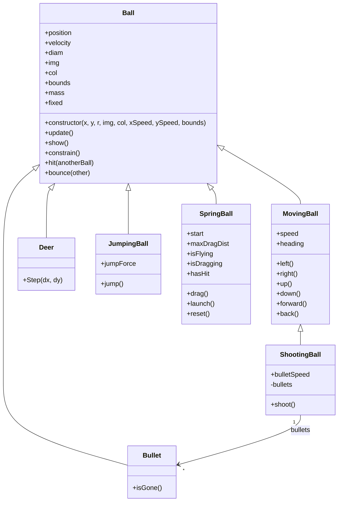

# Minigame

En samling af tre små browserspil lavet med p5.js. Hvert spil varer 20 sekunder, og du får 10 point pr. sekund, du overlever. Til sidst kan du gemme din score på highscore-listen.

## Spillene

- **Dino** – Hop over forhindringerne med mellemrumstasten.
- **Oh Deer!** – Styr hjorten med piletasterne, og undgå bilerne der kører over vejen.
- **Midnight Driving** – Under udvikling.

## Sådan starter du spillet

1. Klon repoet: `git clone https://github.com/Toke-AT/minigame.git`
2. Åbn mappen i VS Code.
3. Højreklik på `index.html`, og vælg **Open with Live Server** (kræver udvidelsen Live Server).
4. Vælg et spil på startskærmen.

